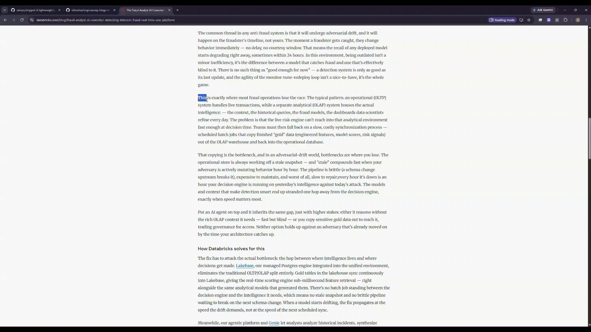

```
               _                  __ 
   _________  (_)___  ____  ___  / /_
  / ___/ __ \/ / __ \/ __ \/ _ \/ __/
 (__  ) / / / / /_/ / /_/ /  __/ /_  
/____/_/ /_/_/ .___/ .___/\___/\__/  
            /_/   /_/                
```

> Your local AI companion for the text you are working with.

Snippet is a small Windows desktop assistant for those moments when you need a
quick answer about something on your screen. Highlight text in any app, press a
shortcut, and get a streamed response from a local Ollama model in a lightweight
popup.

It is made for the little questions that come up while you work: explain a
passage, summarize a section, refine a sentence, or ask about the text in front
of you without breaking your flow.

<p align="center">
  
</p>

## Features

- **System-wide selection capture** — select text in a browser, editor, or other
  desktop application and press `Ctrl + Shift + Space`.
- **Current-monitor capture** — press `Ctrl + Shift + I` to attach a resized
  screenshot of the monitor under your cursor for a vision-capable Ollama model.
- **Region capture** — press `Ctrl + Shift + G`, then drag over the part of the
  screen you want Snippet to analyze.
- **Read screen** — extract text, tables, code, and math from a capture with a
  local OCR model before reasoning about it.
- **Local Ollama inference** — send prompts to a model running on your machine.
- **Streaming responses** — see the answer as it is generated.
- **Markdown answers** — read headings, lists, tables, links, and code in a
  compact, desktop-native format.
- **Quick actions and custom prompts** — explain, summarize, refine, or provide
  your own instruction.
- **Persistent local settings** — configure the Ollama address and selected model
  once; Snippet remembers them.
- **Compact desktop UI** — borderless, always-on-top, cursor-positioned popup
  that stays out of your taskbar.
- **Runs from the system tray** — close the popup without stopping Snippet; open
  it, change settings, or quit from the tray menu.
- **Optional launch at sign-in** — enable it during first-run setup or later in
  Settings → General to keep shortcuts ready in the background.
- **Safe clipboard handling** — restores prior plain-text clipboard content when
  possible after capturing a selection.

## How it works

```text
Select text in any application
        ↓
Ctrl + Shift + Space
        ↓
Snippet captures the selection
        ↓
PromptBuilder creates chat messages
        ↓
Ollama streams a local response
        ↓
Snippet displays the answer
```

## Requirements

- Windows
- Node.js and a Rust toolchain for development
- [Ollama](https://ollama.com/) installed locally
- At least one installed Ollama chat model

## Getting started

From the project directory:

```powershell
npm install
npm run tauri dev
```

Then:

1. Snippet opens its first-run setup screen. Install Ollama if needed, confirm
   the address (the default is `http://localhost:11434`), and select an
   installed model.
2. Choose whether Snippet should launch when you sign in, then finish setup.
3. Highlight text in another application and press `Ctrl + Shift + Space`.
4. Choose a quick action or enter an instruction.

If Ollama is reachable but no model is listed, install one with Ollama before
continuing:

```powershell
ollama pull <model-name>
```

## Configuration

Snippet stores its runtime settings in the Windows app-config directory:

```text
%APPDATA%\com.snippet.app\settings.json
```

The file contains the Ollama address and selected model:

```json
{
  "ollamaBaseUrl": "http://localhost:11434",
  "model": "your-model-name",
  "ocrModel": "glm-ocr:latest",
  "ocrNumPredict": 2048,
  "ocrNumCtx": 16384,
  "thinking": false,
  "visionEnabled": false
}
```

Enable image input only when the selected Ollama model supports screenshots.
The current-monitor and region-capture shortcuts are configurable alongside the
text-action shortcuts; they default to `Ctrl + Shift + I` and `Ctrl + Shift + G`.
Read screen and Read region are separate shortcuts, defaulting to
`Ctrl + Shift + O` and `Ctrl + Shift + T`. They open Snippet immediately,
extract the capture in the background, and use the result as selected text
once it is ready. A prompt or text action chosen while OCR is running is sent
automatically after extraction completes. Configure any shortcut by clicking
its value in Settings and pressing the desired key combination.
Read screen uses `glm-ocr:latest` by default and can be changed in Settings.
Install the default model with `ollama pull glm-ocr:latest`.
Its output and context limits are available under Settings → Read screen.

For development, `SNIPPET_OLLAMA_MODEL` overrides the saved model name without
changing the settings file. Thinking is disabled by default for faster replies;
enable it in Settings when you prefer more deliberate model responses.

### Development tools

Selected-text and generated-prompt previews are disabled by default. To enable
them for your machine, create an ignored `.env.development.local` file:

```env
VITE_SHOW_DEVELOPMENT_TOOLS=true
```

The tracked `.env.development` keeps this flag off by default, and release builds
always exclude these preview controls.

### Running in the background

Snippet has no normal application window after it starts. It remains available
from the Windows system tray and through its configured global shortcuts. The
popup's close button and `Esc` only hide the popup; choose **Quit Snippet** from
the tray menu to stop it completely.

The first-run setup offers **Launch Snippet when I sign in**. You can change the
setting at any time under Settings → General. It starts the hidden tray utility
at sign-in; it does not start Ollama or a model until you ask Snippet to do
something.

## Architecture

```text
src-tauri/src/
├── selection.rs        Windows clipboard-based text capture
├── prompt.rs           Provider-neutral prompt construction
├── provider/
│   ├── mod.rs          LLM provider contract
│   └── ollama.rs       Ollama HTTP and streaming implementation
├── settings.rs         Persisted local AI configuration
└── lib.rs              Tauri commands, events, and application lifecycle
```

The capture, prompt, and provider layers are intentionally independent. That
keeps the current Ollama integration replaceable and leaves room for future
capture strategies without changing the popup interaction.

## Development

```powershell
# Build the frontend
npm run build

# Run the Rust test suite
cargo test --manifest-path src-tauri/Cargo.toml

# Create a bundled desktop build
npm run tauri build
```

## Releases

Public Windows builds are published as an NSIS setup executable on the project's
GitHub Releases page. The installer is intentionally per-user, so it should not
need administrator permission.

The repository's release workflow runs when a `vX.Y.Z` tag is pushed. Before
using it, update the version in `src-tauri/tauri.conf.json` and create the tag
with the same version. The workflow publishes an unsigned installer; Windows may
show a SmartScreen warning for a new or unsigned project. Download only from the
official GitHub Releases page and verify the published SHA-256 checksum when one
is provided.

## Privacy

By default, Snippet sends selected text only to Ollama at `localhost`. If you
configure a different Ollama address, that server receives the selected text
instead.

## Contributing

Contributions, issues, and ideas are welcome. Please keep changes focused,
preserve the separation between capture, prompt, and provider layers, and add
tests for backend behavior where practical.
